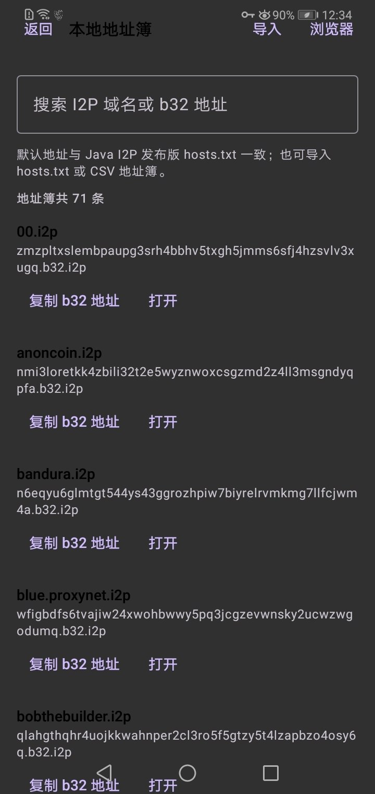
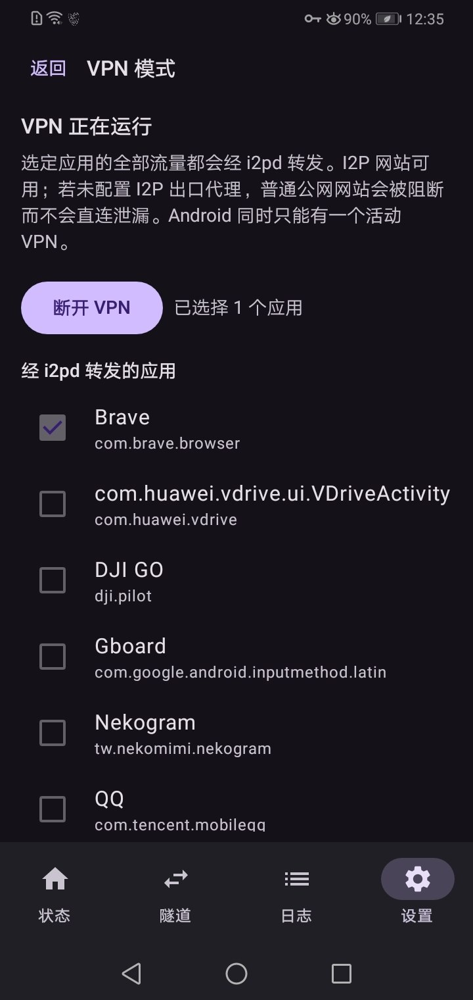
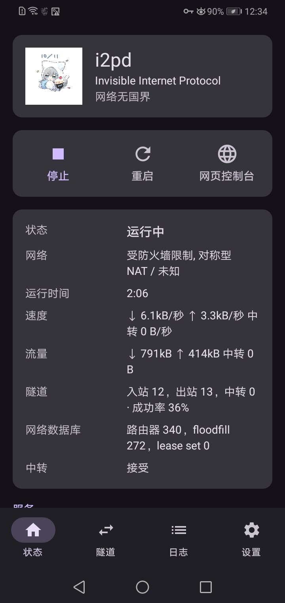
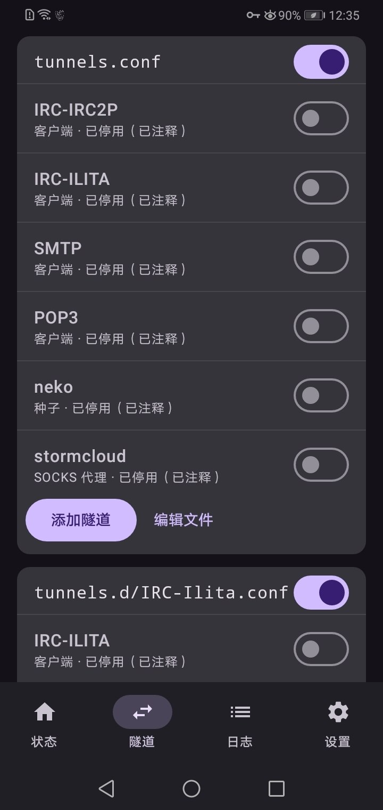
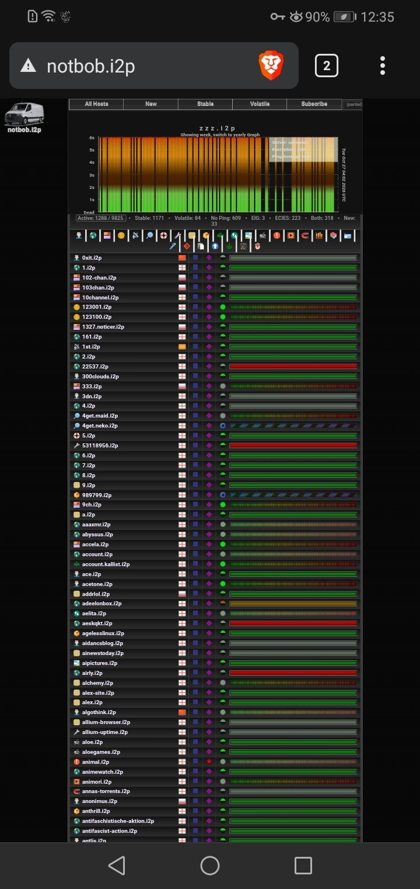

# Neko-i2pd Android

[简体中文](README.md) · [English](README.en.md) · [Русский](README.ru.md)

这是基于 [PurpleI2P/i2pd-android](https://github.com/PurpleI2P/i2pd-android) 3.0.0 的非官方 Android 分支，当前应用版本为 **3.0.1**。分支 `android-vpn-webapps` 增加地址簿导入/搜索、应用内 I2P 浏览器和按应用 VPN 分流，并保留 i2pd 原有控制台与隧道功能。它不是 PurpleI2P 官方发行版。

## 项目预览

以下截图由项目使用者提供，展示地址簿、隧道配置、VPN 分流和路由器状态等界面。点击图片可查看原尺寸。

<a href="docs/screenshots/address-book-b32.jpg"></a>

**本地地址簿与 b32：**搜索 `.i2p` 域名、查看并复制其 b32 地址。

<a href="docs/screenshots/vpn-app-selection.jpg"></a>

**VPN 分流：**选择要经过 i2pd 的应用。

<a href="docs/screenshots/router-status.jpg"></a>

**路由器状态：**运行状态、网络与隧道统计。

<a href="docs/screenshots/tunnel-settings.jpg"></a>

**隧道设置：**查看和管理现有隧道配置。

<a href="docs/screenshots/i2p-site-in-browser.jpg"></a>

**I2P 网站：**用户提供的 `.i2p` 页面访问截图。

## 已实现功能

- **地址簿搜索与导入：**内置 71 条 Java I2P 发布版 [`hosts.txt`](https://github.com/i2p/i2p.i2p/blob/b21f0c5ee22edc4fb7fa0bc4bd8cca255e629ec0/installer/resources/hosts.txt) 快照记录，可搜索域名、查看/复制对应 b32 地址，并导入标准 `hosts.txt` 或 `hostname,b32` CSV。默认数据是固定快照，不会自动同步更新。导入采用新增合并，已有同名记录优先；运行中的路由器需重启后才会按新导入域名解析。
- **应用内 I2P 浏览器：**通过本机 i2pd HTTP 代理 `127.0.0.1:4444` 访问 `.i2p` 页面，只允许 `.i2p` 主页面和站内资源；不支持代理覆盖的系统 WebView 会显示提示，不会退回公网直连。
- **按应用 VPN：**在 VPN 设置中选择应用，使用 Hev Socks5 Tunnel 2.19.3（API 23 原生构建）把所选应用流量转向本机 i2pd SOCKS5 `127.0.0.1:4447`。Android 通常一次只能运行一个 VPN。若没有配置可用的 I2P outproxy，普通公网连接可能被阻断；VPN 故障时不会悄悄直连公网。
- **WebApps 门户：**Mail（`mail.i2p`）和 Web IRC（`webirc.coldhell.i2p`）可从控制台在应用内浏览器打开。它们是 I2P 网络中的服务入口，不是 APK 内置的邮件或 IRC 服务器。
- **控制台背景图：**可从手机照片选择或清除控制台背景。
- **原有隧道和控制台：**保留 i2pd 原有功能；本分支尚未新增独立的 BitTorrent 下载/做种 WebApp。

## Android 兼容性

目标覆盖多数常见 Android 设备和模拟器：**Android 6.0/API 23 或更高版本**，包含 `arm64-v8a`、`armeabi-v7a`、`x86`、`x86_64` 四种 ABI。不能保证适用于所有厂商固件或设备组合；内置浏览器还取决于设备 WebView 对 `PROXY_OVERRIDE` 的支持情况。当前验证包括 APK 构建及单元测试，不等于在所有机型上的实机测试。

## 下载

从 [GitHub Releases](https://github.com/ke-lala/nekopd/releases) 获取 APK。3.0.1 安装包为 **debug 签名测试版**，可侧载测试；不是 Google Play 发布签名，也不应当作正式安全审计后的稳定发行版。

## 从源码构建

需要 JDK 17 或更高版本、Android SDK（API 37）、NDK `29.0.14206865`、`make`、`cmake`、`perl`、`curl` 和 `zip`。获取源码并初始化 i2pd 子模块：

```bash
git clone --recurse-submodules --branch android-vpn-webapps \
  https://github.com/ke-lala/nekopd.git
cd nekopd
export ANDROID_HOME="$HOME/Android/Sdk"
export ANDROID_SDK_ROOT="$ANDROID_HOME"
export ANDROID_NDK_HOME="$ANDROID_HOME/ndk/29.0.14206865"
binary/jni/build.sh
./gradlew :app:assembleDebug
```

通用调试 APK 输出在 `app/build/outputs/apk/debug/`。正式发布请使用自己的签名密钥；不要把密钥、密码或 `keystore.properties` 提交到仓库。

## AI 使用说明

本分支的代码实现、README 编写和翻译使用了 AI 辅助。AI 辅助不等于安全审计，也不代表已在所有安卓设备上完成测试；兼容性说明仅限上述 API/ABI 目标和已执行的构建/测试。

## 上游与许可证

本项目基于 [PurpleI2P/i2pd-android](https://github.com/PurpleI2P/i2pd-android) 和 [PurpleI2P/i2pd](https://github.com/PurpleI2P/i2pd)。VPN 数据面使用 [Hev Socks5 Tunnel](https://github.com/heiher/hev-socks5-tunnel)，其 MIT 许可证随项目提供。请同时查阅各上游项目及依赖的许可证文件。
